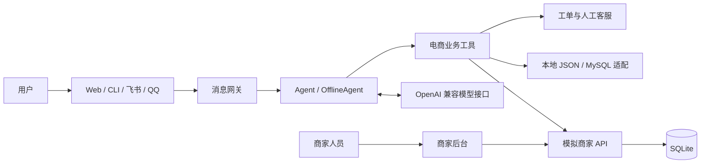

# NanoClaw Commerce · 电商智能客服


面向商品咨询、订单查询与售后处理的智能客服应用。将电商业务封装为 Agent 工具，并提供独立的模拟商家 API 和后台，用于演示客服与商家业务的联动。

[功能特性](#功能特性) · [系统架构](#系统架构) · [快速开始](#快速开始) · [配置指南](docs/configuration.md) · [开发指南](docs/development.md)

## 功能特性

| 模块 | 功能 |
| --- | --- |
| 商品服务 | 商品搜索、详情查询、下单与用户偏好记录 |
| 订单服务 | 订单查询、收货地址更新与物流查询 |
| 售后服务 | 退货资格检查、退款规则判断、售后工单 |
| 人工接入 | 转人工客服与客服工作台 |
| 模拟商家 | 商品、库存、订单、物流、售后与经营看板 |
| 运行模式 | 模型驱动的 Agent 与无模型密钥的离线规则 Agent |
| 交互渠道 | Web、命令行、飞书与 QQ |

## 系统架构



客服与商家服务独立运行，分别监听 `8080` 和 `8090` 端口。商品查询默认接入模拟商家 API；客服本地账号与订单数据需要单独初始化。MySQL 和 Redis 接入属于可选扩展。

## 技术栈

- **Agent**：Python、NanoClaw 执行循环、工具调用、离线规则路由。
- **服务**：FastAPI、Uvicorn、HTTP API。
- **数据与认证**：SQLite、JSON、JWT、bcrypt；可选 MySQL/Redis。
- **前端与渠道**：HTML/JavaScript、Web、飞书与 QQ SDK。

## 快速开始

### 1. 获取项目

```bash
git clone https://github.com/chuantiet5-stack/nanoclaw-ecommerce-support.git
cd nanoclaw-ecommerce-support
```

建议分别创建虚拟环境，见[开发指南](docs/development.md)。

### 2. 启动模拟商家

```bash
cd 模拟商家页面
python -m pip install -r requirements.txt
python main.py
```

首次启动自动建表并生成模拟数据。

| 入口 | 地址 |
| --- | --- |
| 商家后台 | <http://127.0.0.1:8090/merchant> |
| 接口文档 | <http://127.0.0.1:8090/docs> |
| 健康检查 | <http://127.0.0.1:8090/health> |

模拟商家账号见[商家服务说明](模拟商家页面/README.md)。这些账号与客服端本地账号分别管理。

### 3. 启动客服

在另一个终端，从仓库根目录执行：

```bash
cd 客服页面
python -m pip install -r requirements-lite.txt
python -c "import shutil; shutil.copyfile('config.example.json', 'config.json')"
```

按[配置指南](docs/configuration.md#初始化客服数据)创建本地数据文件与测试账号，再执行：

```bash
python main.py
```

访问 <http://127.0.0.1:8080>。`api_key` 留空时使用离线规则 Agent；填写自己的 API 密钥与模型配置后使用在线 Agent。

## 项目结构

```text
.
├── 客服页面/                      # 客服应用
│   ├── agent/tools/ecom/          # 电商业务工具与数据适配
│   ├── channels/                  # 交互渠道与客服页面
│   ├── data/                      # 本地数据结构示例
│   ├── db/                        # 数据模型与访问层
│   ├── migrations/                # 数据迁移
│   ├── security/                  # 登录、JWT 与密码校验
│   ├── tests/                     # 客服与业务逻辑测试
│   ├── config.example.json
│   └── main.py
├── 模拟商家页面/                  # 独立模拟商家服务
│   ├── mock_merchant/             # API、规则、种子数据与后台
│   ├── tests/                     # 商家 API 集成测试
│   └── main.py
└── docs/                          # 配置与开发文档
```

## 文档

- [配置与数据初始化](docs/configuration.md)：模型、测试账号、数据后端与服务连接。
- [开发与测试](docs/development.md)：依赖选择、测试命令与业务工具入口。
- [商家服务说明](模拟商家页面/README.md)：模拟账号、API 与业务流程。

本地凭证、账号、订单与会话数据由 `.gitignore` 排除，示例文件仅保留可公开的数据结构。
