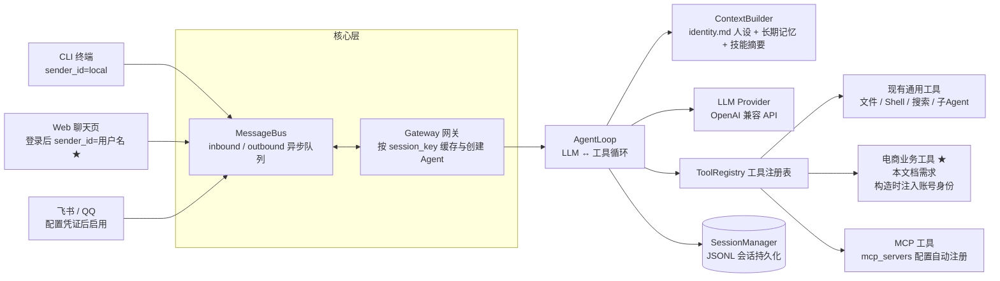

# 电商 Agent 需求文档（基于 NanoClaw 当前架构）

> 适用项目：当前 `nanoclaw` 仓库。
>
> 本文档完全基于项目现有架构编写：**不重构、不换技术栈、不新建工程**。所有电商业务能力以「工具（Tool）」的形式插入现有 `ToolRegistry`：配置 LLM API key 时由 LLM 在对话中自动调用；**未配置任何 API key 时自动进入离线模式（关键词规则路由），全部业务同样可对话式演示**；演示脚本中亦可直接调用。
>
> 本文档只定义产品与工程要求，撰写本文档本身不修改任何代码。

## 1. 目标与原则

将当前 NanoClaw 智能助手扩展为一个**可演示的电商客服 Agent**：顾客通过 CLI 或 Web 聊天页即可完成商品咨询与推荐、账号登录、订单查询、物流跟踪、售后申请、工单创建与进度查询、账号偏好记忆、兜底转人工等完整业务闭环。

### 1.1 五条硬性原则

| # | 原则 | 含义 |
| --- | --- | --- |
| 1 | 保留架构 | Gateway 多渠道网关、MessageBus、AgentLoop、ToolRegistry、SessionManager、LLM Provider、MCP、Skills 全部保留原样，不改目录结构、不引入新框架 |
| 2 | 业务工具化 | 每个电商业务能力 = 一个继承 `agent/tools/base.Tool` 的工具类，在 `main.py build_agent()` 中与现有工具同等注册 |
| 3 | 可直接调用 | 业务工具既可被 Agent 在对话中自动调用，也可在演示/测试脚本中通过 `ToolRegistry.execute()` 直接调用（不消耗 LLM token） |
| 4 | 演示自包含 | 所有业务数据为本地模拟数据（`data/` 目录），不依赖任何真实电商平台凭证即可演示完整流程 |
| 5 | 账号隔离 | 个人数据（订单、物流、售后、记忆）只能以登录账号身份访问；账号记忆与订单按账号绑定，跨渠道共享；无法解决时兜底转人工 |

### 1.2 实施方式约定

- 后续实施只允许四类改动：**新增工具与数据文件**、**在 `main.py build_agent()` 中追加注册与身份解析**、**更新 `identity.md` 人设文案**、**渠道层登录增强（仅 `channels/web.py`、`channels/web_ui/index.html`、`channels/cli.py`）**。
- 不修改任何核心模块的内部逻辑（`gateway.py`、`agent/loop.py`、`agent/tools/registry.py`、`agent/tools/base.py`、`session/manager.py`、`providers/`、`bus/`）。

## 2. 当前架构（全部保留）

### 2.1 架构总览



### 2.2 消息流转链路

1. 渠道（CLI/Web/飞书/QQ）将用户消息封装为 `InboundMessage` 发布到 `bus.inbound_queue`。
2. `Gateway._process_inbound()` 消费消息，构造 `session_key = "{channel}:{sender_id}"`，从缓存获取或通过 `agent_factory` 创建对应 AgentLoop。
3. `AgentLoop.run()` 由 `ContextBuilder` 构建完整 messages（人设 + 时间 + 记忆 + 历史 + 当前消息），调用 LLM。
4. LLM 返回 `tool_calls` 时，经防爆检测后由 `ToolRegistry.execute(name, arguments)` 执行，结果以 tool message 回传给 LLM，循环直到生成最终回复。
5. 回复封装为 `OutboundMessage` 发布到 `bus.outbound_queue`，由 Gateway 分发回对应渠道。

**账号身份的传递路径（本期新增需求的关键落点）**：Web 渠道登录成功后，该连接的后续消息以 `username` 作为 `sender_id` 发送 → Gateway 生成 `session_key = "web:{username}"` → `build_agent(session_key)` 解析出用户名 → 注入到业务工具构造参数。整条链路复用现有机制，核心层零修改。

**离线分支（本期新增）**：`config.api_key` 为空时，`build_agent()` 返回同接口的 `OfflineAgent`（关键词规则路由，见 3.6），上述链路仅第 3-4 步的「LLM 决策」被替换；渠道、网关、工具执行、会话持久化完全复用。

### 2.3 模块与文件清单（当前实际存在）

| 模块 | 文件 | 职责 |
| --- | --- | --- |
| 入口 | `main.py` | 加载配置 → MessageBus → 连接 MCP → 注册渠道 → 启动 Gateway；`build_agent(session_key)` 完成工具注册与 AgentLoop 组装 |
| 配置 | `config.py` / `config.json` | `NanoClawConfig`：api_key、base_url、models（main/subagent/cheap）、workspace、max_iterations、feishu/qq/web 渠道开关、mcp_servers |
| 网关 | `gateway.py` | 多渠道接入核心，按 session_key 缓存 Agent 实例，路由入站/出站消息 |
| 消息总线 | `bus/queue.py` | `MessageBus`（asyncio.Queue）与 `InboundMessage` / `OutboundMessage` 结构 |
| 渠道 | `channels/base.py` | `Channel` 抽象基类（`start()` / `send()` / `stop()`） |
| | `channels/cli.py` | CLI 交互渠道（默认启用，支持 `/exit`、`/clear`、`/tools` 命令，sender_id 固定为 `local`） |
| | `channels/web.py` + `web_ui/index.html` | FastAPI + WebSocket 聊天渠道（默认启用，`http://host:port`；当前 sender_id 为随机 uuid，登录增强见第 4 章） |
| | `channels/feishu.py` / `channels/qq.py` | 飞书 / QQ 渠道适配（配置 app_id/app_secret 后自动启用） |
| Agent 核心 | `agent/loop.py` | LLM ↔ 工具主循环；最大迭代（默认 32）、防爆熔断（重复调用 10 次警告 / 20 次熔断）、Token 压缩 |
| | `agent/context.py` | 组装 system prompt：identity.md 人设 + 当前时间 + `workspace/memory/MEMORY.md` 长期记忆 + 技能摘要 |
| | `agent/memory.py` | `MemoryConsolidator`：token 预算（16000）超限时压缩历史 |
| | `agent/skills.py` | `SkillsLoader`：扫描 `skills/*/SKILL.md` 注入技能摘要 |
| 工具框架 | `agent/tools/base.py` | `Tool` 抽象基类：name / description / parameters / execute，自动生成 OpenAI function calling 定义 |
| | `agent/tools/registry.py` | `ToolRegistry`：register / get_definitions / execute / list_tools |
| 现有工具 | `agent/tools/filesystem.py` `shell.py` `web_search.py` `web_fetch.py` `spawn.py` | read_file、write_file、list_dir、exec、web_search、web_fetch、spawn_subagent |
| | `agent/tools/mcp_server.py` | `MCPClientManager` + `MCPTool`：stdio 连接 MCP Server，工具命名 `{server}__{tool}` |
| LLM | `providers/base.py` `providers/openai_compat.py` | `LLMProvider` 抽象与 OpenAI 兼容实现（当前对接硅基流动） |
| 会话 | `session/manager.py` | JSONL 持久化，`workspace/sessions/{channel}_{sender_id}.jsonl` |
| MCP 示例 | `mcp_servers/poetry_server.py` | 古诗词查询 MCP Server（业务工具封装为外部服务的参考范例） |
| 技能 | `skills/code_review` `translator` `weather` | SKILL.md 技能定义 |
| 人设 | `identity.md` | Agent 角色与行为准则（电商化改造点，见第 7 章） |

### 2.4 现有能力盘点

- **多渠道**：CLI、Web（免凭证）、飞书、QQ，统一经 Gateway 接入，按 session_key 天然多会话隔离。
- **工具循环**：OpenAI function calling 全自动路由，含防爆熔断与最大迭代保护。
- **会话持久化**：JSONL 按 session 落盘，重启自动恢复历史。
- **上下文工程**：人设文件、长期记忆、技能摘要、Token 压缩齐备。
- **MCP 扩展**：任何能力可封装为 stdio MCP Server 自动接入。
- **多模型分工**：models.main 主对话 / subagent 子任务 / cheap 轻量任务。

## 3. 业务工具插入机制（核心扩展点）

这是本期需求的实现核心：**电商业务 = 插入 ToolRegistry 的工具集合**。

### 3.1 工具规范

每个业务工具必须继承 `agent/tools/base.py` 的 `Tool` 基类并实现四要素：

| 要素 | 要求 |
| --- | --- |
| `name` | 全局唯一、snake_case（如 `query_order`），与现有工具风格一致 |
| `description` | **面向 LLM 的用途说明，是意图路由的唯一依据**。必须写清：适用场景、输入输出、调用前置条件（如"仅在顾客明确确认后调用"、"顾客未登录时返回未登录提示"） |
| `parameters` | OpenAI function calling JSON Schema，明确参数类型与 required |
| `execute` | 异步方法，读取 `data/` 模拟数据，返回**易读的文本结果**（当前 Tool 接口返回 str；结构化信息以简洁 Markdown 呈现） |

### 3.2 注册方式

在 `main.py` 的 `build_agent()` 中，与现有工具同等注册。由于 `build_agent` 已接收 `session_key` 参数，注册时可同时完成**身份注入**（示意，属于后续实施改动）：

```python
def build_agent(config, session_key: str, mcp_manager=None):
    # session_key 形如 "web:han"（已登录）或 "web:guest-a1b2c3"（未登录）
    channel, _, actor = session_key.partition(":")
    is_logged_in = actor in users  # users 来自 data/users.json

    tools.register(SearchGoodsTool())                    # 公共工具，无需身份
    tools.register(QueryOrderTool(actor=actor,           # 个人数据工具，注入身份
                                  logged_in=is_logged_in))
    tools.register(RememberPreferenceTool(actor=actor,
                                          logged_in=is_logged_in))
    ...
```

注册后立即获得两项能力：`/tools` 命令可见、LLM function calling 可自动调用。

### 3.3 两种调用方式

| 方式 | 路径 | 用途 |
| --- | --- | --- |
| Agent 自动调用 | 顾客对话 → AgentLoop → LLM 依据工具 description 自主选择并调用 | 真实业务演示 |
| 直接调用 | 演示/测试脚本 `await registry.execute("query_order", {"order_id": "..."})` | 不消耗 LLM token，验证工具本身正确性；也是验收手段 |

### 3.4 可选：MCP 路线

业务也可封装为 stdio MCP Server（参考 `mcp_servers/poetry_server.py` 的 FastMCP 模式），在 `config.json` 的 `mcp_servers` 添加条目即自动注册为 `{server}__{tool}`。

- **内置 Tool（推荐）**：实现简单、可直接 execute、无跨进程开销。
- **MCP Server**：能力可被其他 MCP 客户端复用，但演示链路更长。

本期默认内置 Tool 路线；MCP 路线保留为可选扩展，两者不冲突。

### 3.5 工具设计约定

1. **公共工具免登录**：商品搜索、商品详情属公共信息，未登录也可调用。
2. **个人数据工具强制登录**：订单、物流、售后、工单进度、账号记忆工具在未登录（guest）状态下返回统一提示「请先登录」，由 Agent 转述并引导用户点击登录；工具不得返回任何订单数据。
3. **写操作需确认**：`update_address`、`create_ticket` 属写操作，其 description 必须注明"仅在顾客明确确认后调用"；Agent 应先复述操作内容（订单号、变更项、影响），收到明确确认（如"确认"）后才调用。`remember_preference` 为低风险写（记录偏好），可直接执行。
4. **归属校验**：个人数据工具内部校验目标订单的 `customer_id` 与当前登录账号一致；不一致时返回「无权查询该订单」，不返回任何订单内容。
5. **脱敏**：订单中的收件人手机号、完整地址在返回文本中部分掩码（如 `138****5678`）。
6. **不编造**：工具返回什么就答什么；查不到（订单号不存在）如实告知，不得虚构状态。

### 3.6 离线演示模式（无 LLM API key）

目标：**所有业务可演示，即使没有配置任何 LLM API key**。LLM 只是工具的「调用决策者」，业务执行本身（登录校验、订单/物流/售后读写、记忆读写、工单创建）完全不依赖 LLM。

**设计基础**：Gateway 对 Agent 实例的唯一依赖是 `run(user_message) -> str` 接口（外加 CLI 注入的 `tools` 属性，见 [gateway.py](file:///d:/liulandowload/nanoclaw/gateway.py) `_process_inbound`）。因此离线模式实现为新增的 `OfflineAgent` 类（新文件 `agent/offline_agent.py`，与 `AgentLoop` 同接口）：`build_agent()` 在 `config.api_key` 为空时返回 `OfflineAgent`，Gateway、MessageBus、渠道、工具注册与身份注入全部零修改复用。

**组成**：

| 组件 | 说明 |
| --- | --- |
| 关键词路由表 | 意图关键词 →（工具， 参数提取）：`推荐/买 + 价格` → search_goods；`SO` 开头订单号 → query_order；`物流/到哪` → query_logistics；`退货` → check_return_eligibility；`改地址` → update_address；`转人工/人工` → escalate_to_human；`记住` → remember_preference；`多大码/我的偏好` → get_my_profile |
| 回复模板 | 工具结果套固定话术（致谢、引导下一步），保证对话体验完整 |
| 确认状态机 | 写操作（改地址、建工单）先复述并挂起，收到「确认」才执行——与在线模式的确认约定一致 |
| 兜底规则 | 连续 2 轮无法识别，或顾客表达不满（「不行」「没用」等）→ 自动调用 escalate_to_human，与在线兜底触发条件对齐 |

**边界说明**：

- 离线模式仅关键词匹配，无自然语言理解，定位是**演示兜底而非 LLM 替代**；智能对话仍需配置 API key。
- 登录在渠道层完成（users.json 校验），不依赖 LLM，因此离线模式下登录、账号记忆、权限拦截照常工作。

**启动方式**：`python main.py` 时未配置 api_key（config.json 与 `NANOCLAW_API_KEY` 环境变量均为空）→ 打印「未配置 LLM API key，进入离线演示模式」→ 正常启动 CLI/Web 渠道，全部业务可对话演示。

## 4. 账号与登录（本期新增核心需求）

### 4.1 账号体系（演示级）

| 项 | 设计 |
| --- | --- |
| 账号存储 | `data/users.json`：username、password（演示级，可明文或简单哈希）、customer_id、name |
| 预置账号 | ≥ 2 个演示账号（如 `han` / `li`），分别绑定不同顾客 ID，订单数据按 customer_id 归属 |
| 登录范围 | 仅 Web 渠道实现完整登录流程；CLI 演示时以预绑定演示账号启动（见 4.4） |
| 安全级别 | 演示级：不做 JWT、验证码、限流、加密存储；生产级 IAM 明确不在本期范围（见第 10 章） |

### 4.2 Web 登录流程（渠道层增强）

允许改动的文件仅限 `channels/web.py` 与 `channels/web_ui/index.html`，核心层零修改：

1. **登录前（游客态）**：WebSocket 连接的 sender_id 为 `guest-{uuid}`（现状即随机 uuid，仅统一前缀便于工具识别）。游客可闲聊、商品咨询、商品推荐（公共工具），不能查询任何个人数据。
2. **登录入口**：聊天页提供登录按钮 + 账号密码表单（页面内弹层或顶部栏）。
3. **登录成功**：该连接后续消息的 sender_id 改为 `username` → Gateway 生成新 session_key `web:{username}` → 自动加载该账号的历史会话（SessionManager 按 session_key 恢复，架构天然支持）→ 业务工具身份切换为该顾客。页面显示当前登录用户名。
4. **登录失败**：提示账号或密码错误，保持游客态。
5. **会话衔接说明**：登录后开启账号会话，游客期的对话历史不自动合并到账号会话（演示可接受，文档明示）。

### 4.3 身份注入与数据隔离

- `build_agent(session_key)` 解析 actor（见 3.2 示例），以构造参数注入各个人数据工具。
- **未登录拦截**：个人数据工具统一返回「请先登录后再查询订单信息」，Agent 转述并引导登录。
- **越权拦截**：登录账号 A，输入账号 B 的订单号 → 工具返回「无权查询该订单」（不透露该订单是否存在）。
- **登出（可选）**：聊天页提供登出按钮，登出后连接回到游客态。

### 4.4 CLI 演示账号

CLI 的 sender_id 当前固定为 `local`。演示时以预绑定演示账号启动：`build_agent` 对 `cli:` 前缀的 session_key 统一映射为 `data/users.json` 中的默认演示账号（如 `han`），即可直接演示订单查询、记忆等登录态功能。CLI 不需要登录界面。

### 4.5 账号绑定记忆（可演示）

将「顾客偏好」沉淀为按账号存储的记忆文件，与会话历史区分，跨渠道共享：

| 项 | 设计 |
| --- | --- |
| 存储 | `data/memory/{username}.md`，每账号一个文件，Markdown 列表，运行时追加 |
| 写入时机 | Agent 在对话中识别到顾客偏好（尺码、预算、品类偏好、收货习惯、纪念日等）时，主动调用 `remember_preference` 记录 |
| 读取时机 | 涉及个性化推荐或顾客询问自身偏好时，调用 `get_my_profile` 读取档案与偏好 |
| 与会话的区别 | 会话历史（JSONL，按 session_key）是对话记录，`/clear` 可清空；账号记忆是沉淀档案，`/clear` **不清除**，重启、换浏览器、换渠道登录同一账号仍在 |
| 跨渠道共享 | 记忆按账号（username）存储，Web 与 CLI（预绑定同账号）读取同一份记忆 |

**演示链路**：登录 → 「记住我平时穿 42 码的鞋」→ Agent 调用 `remember_preference` 写入 → `/clear` 清空会话或断开重连 → 「我平时穿多大码的鞋？」→ Agent 调用 `get_my_profile` → 「您之前告诉我们平时穿 42 码」。

## 5. 电商业务工具需求

### 5.1 账号与记忆域（个人数据，需登录）

| 工具 | 功能 | 关键参数 | 返回内容 |
| --- | --- | --- | --- |
| `get_my_profile` | 读取当前登录顾客的档案与偏好记忆 | 无（身份由构造注入） | 姓名（脱敏）、顾客等级、历史偏好列表（尺码、预算、品类等） |
| `remember_preference` | 将顾客偏好写入账号记忆文件 | content（偏好描述，如"平时穿 42 码鞋"） | 写入确认；未登录返回登录提示 |

### 5.2 商品域（公共，免登录）

| 工具 | 功能 | 关键参数 | 返回内容 |
| --- | --- | --- | --- |
| `search_goods` | 按关键词 / 品类 / 预算 / 用途搜索商品 | keyword、category（可选）、max_price（可选）、purpose（可选） | 商品列表：SKU、名称、价格、核心卖点、库存 |
| `get_goods_detail` | 按 SKU 查商品详情 | sku | 详情：价格、规格（尺码/颜色）、库存、商品简介、购买链接 |

推荐场景约定：先收集预算、用途、偏好（可由对话上下文与账号记忆获得），再调用 `search_goods`，回复时给出**对比理由**而非罗列；顾客已登录且记忆中有尺码等偏好时，推荐应结合偏好（先 `get_my_profile`）。

### 5.3 订单域（个人数据，需登录 + 归属校验）

| 工具 | 功能 | 关键参数 | 返回内容 |
| --- | --- | --- | --- |
| `query_order` | 查当前登录顾客的订单 | order_id | 订单状态、商品明细、金额、收货信息（脱敏）、下单时间；未登录/非本人订单返回对应提示 |
| `update_address` | 修改**未签收**订单的收货地址（写操作，需确认） | order_id、new_address | 修改结果；订单已签收 / 不存在 / 非本人订单时返回失败原因 |

### 5.4 物流域（个人数据，需登录 + 归属校验）

| 工具 | 功能 | 关键参数 | 返回内容 |
| --- | --- | --- | --- |
| `query_logistics` | 按订单号查物流轨迹 | order_id | 最新节点、轨迹时间线、更新时间；异常件给出建议（如"联系快递"或转工单） |

### 5.5 售后与工单域（需登录）

| 工具 | 功能 | 关键参数 | 返回内容 |
| --- | --- | --- | --- |
| `check_return_eligibility` | 判定订单退换货资格 | order_id、reason | 是否可退换、政策依据（如签收后 7 天内）、所需材料、下一步 |
| `create_ticket` | 创建工单（写操作，需确认） | type（售后/投诉）、order_id（可选）、description | 工单号、类型、SLA 提示 |
| `query_ticket_progress` | 查工单进度 | ticket_id 或 order_id | 工单状态、处理记录、最新更新时间 |
| `escalate_to_human` | **兜底转人工**：自动生成带会话摘要与优先级的人工工单（写操作） | summary、reason、priority（可选，默认普通） | 人工工单号、优先级、预计响应提示 |

`escalate_to_human` 与 `create_ticket` 的分工（写入两者 description，避免 LLM 混淆）：一般售后申请、投诉受理用 `create_ticket`；**兜底转人工**（无法解决、顾客不满意、顾客要求真人）用 `escalate_to_human`，它自动携带对话摘要与优先级。

### 5.6 可选扩展域（本期不强制）

| 工具 | 功能 |
| --- | --- |
| `query_member_points` | 查询会员积分、等级、可用权益 |
| `search_knowledge` | 检索店铺知识库（尺码指南、退换政策、配送范围等 FAQ），用 `data/knowledge.json` 简单关键词匹配即可，不强求向量检索 |

### 5.7 业务意图覆盖对照

| 业务意图 | 落地方式 |
| --- | --- |
| 商品咨询 | LLM 直答 + `get_goods_detail`（有知识库时加 `search_knowledge`） |
| 商品推荐 | `get_my_profile`（已登录时结合偏好）→ `search_goods` → 对比建议 |
| 订单状态 | `query_order`（未登录返回登录提示，Agent 引导登录） |
| 物流跟踪 | `query_logistics` |
| 售后申请 | `check_return_eligibility` → 确认 → `create_ticket` |
| 修改地址 | 复述确认 → `update_address` |
| 投诉 | `create_ticket`（投诉） |
| 显式转人工（"找人工客服"） | `escalate_to_human` |
| **兜底转人工**（无法解决/连续不满意/超权限） | Agent 依据人设触发条件调用 `escalate_to_human`（见 7.2） |
| 记住偏好（"记住我…"） | `remember_preference` |
| 偏好回溯（"我平时穿多大码"） | `get_my_profile` |
| 闲聊/其他 | LLM 直答，不调用业务工具 |

意图路由不建独立模块：由 LLM 依据各工具的 description 自然选择，这正是当前架构 function calling 的原生能力。

## 6. 演示数据

### 6.1 数据文件要求

| 文件 | 内容 | 规模 |
| --- | --- | --- |
| `data/users.json` | 账号（username、password、customer_id、name）+ CLI 默认演示账号标记 | ≥ 2 个账号 |
| `data/memory/{username}.md` | 每账号偏好记忆，运行时追加 | 预置 1 个账号含 1-2 条偏好（演示"读取"），其余运行时写入 |
| `data/goods.json` | SKU、名称、品类、价格、卖点、库存、规格、链接 | ≥ 20 个商品，覆盖运动鞋/服饰/数码等品类 |
| `data/orders.json` | 订单号（如 `SO20260901001`）、**customer_id（归属账号）**、状态（待付款/已付款/已发货/已签收/已完成）、商品、金额、收件信息、下单时间 | ≥ 10 个订单，两个演示账号各有订单且各状态覆盖 |
| `data/logistics.json` | 与订单对应的物流轨迹节点（时间、地点、状态） | 与订单一致 |
| `data/tickets.json` | 示例工单 + 运行时新增 | 预置 ≥ 3 个，支持 append |

### 6.2 数据约定

- 全部为本地静态 JSON / Markdown，工具直接读取；写操作（改地址、建工单、写记忆）回写对应文件。
- 数据自包含，不依赖任何外部平台或网络。
- 可提供 `data/init_demo.py` 一键重置演示数据（可选）。

## 7. 人设与安全边界（identity.md）

将 `identity.md` 更新为电商客服人设（纯文案改动，非代码）。必须包含：

**角色**：店铺智能客服"小纳"，服务范围为商品咨询、推荐、订单物流查询、售后与工单、偏好记忆、人工转接。

**行为准则**：

- 以工具返回和知识库为事实来源，不知道就明说，不编造订单状态或政策。
- 不承诺政策外的价格、时效、补偿；写操作（改地址、建工单）先复述确认再执行。
- 订单号、手机号、地址默认脱敏展示。
- 保持礼貌简洁，主动引导下一步（如"需要我帮您查一下这单的物流吗？"）。
- 顾客未登录而询问个人数据时，转述工具的登录提示并引导使用页面登录。
- 识别到顾客偏好（尺码、预算、品类、习惯等）时，主动调用 `remember_preference` 记录并告知顾客；个性化推荐前先 `get_my_profile` 查看已有偏好。

### 7.2 兜底转人工触发条件（写入人设）

Agent 出现以下任一情形时，**主动**调用 `escalate_to_human` 兜底（而非继续尝试回答）：

1. **顾客明确要求**：出现"转人工"、"找真人客服"、"我要投诉到底"等诉求。
2. **连续未解决**：同一问题顾客连续 2 次表示不满意或问题仍未解决（Agent 需在回复中判断并计数）。
3. **工具无法解决**：订单不存在且顾客坚持有此订单、售后资格不通过且顾客不接受、涉及退款金额争议等超出 Agent 权限的场景。
4. **情绪与风险**：顾客情绪明显激动、提及投诉升级、媒体曝光等风险信号。

兜底动作规范：先向顾客致歉并说明将转接人工 → 调用 `escalate_to_human`（summary 含顾客问题与已尝试的处理）→ 告知工单号与可查询进度 → 不再继续自行处理该问题。

**安全兜底（现有机制直接复用）**：最大迭代 32 次防死循环、工具重复调用熔断、Token 超限自动压缩。

## 8. 演示方案与验收场景

### 8.1 三种演示方式

| 方式 | 操作 | 说明 |
| --- | --- | --- |
| CLI 对话 | `python main.py` | 终端聊天，预绑定演示账号（登录态）；`/tools` 查看工具列表；`/clear` 清空会话（不清账号记忆） |
| Web 聊天 | 启动后浏览器打开 `http://localhost:8080` | 免外部凭证；页面含登录入口；游客可咨询商品，登录后可查订单 |
| 直接调用 | 运行演示脚本（如 `demo_tools.py`，实施阶段产出） | `await registry.execute("query_order", {"order_id": "SO20260901001"})`，不经过 LLM，逐个验证工具 |

### 8.2 验收场景清单

以下场景在 Web 渠道全程可演示（CLI 可演示登录态部分）：

**登录与权限（核心）**

1. **游客咨询商品**：未登录问"推荐 300 元左右的跑步鞋" → `search_goods` 正常推荐（公共能力免登录）。
2. **游客查订单被拦**：未登录问"查一下我的订单" → Agent 引导先登录，不返回任何订单数据。
3. **登录后查订单**：登录账号 han → "查一下订单 SO20260901001" → 返回订单详情，收件信息脱敏。
4. **越权拦截**：登录 han，输入 li 的订单号 → 「无权查询该订单」。
5. **登录失败**：错误密码 → 提示错误，保持游客态，个人数据仍不可查。

**账号绑定记忆（核心）**

6. **偏好写入**：登录后说"记住我平时穿 42 码的鞋" → Agent 调用 `remember_preference` 并确认已记住。
7. **偏好读取**：`/clear` 清空会话（或断开重连、换浏览器重新登录）后问"我平时穿多大码？" → Agent 调用 `get_my_profile` → 答"42 码"。
8. **记忆赋能推荐**：登录后问"给我推荐双鞋" → Agent 先读偏好（42 码）→ 推荐时结合尺码偏好。

**业务闭环**

9. **商品详情**："这双鞋有 40 码吗？" → `get_goods_detail` 查规格库存后回答。
10. **物流跟踪**："我的包裹到哪了？" → 关联订单 → `query_logistics` 给出最新节点。
11. **退货咨询**："我想退货" → `check_return_eligibility` 返回资格结论与政策依据。
12. **确认后建单**：退货场景顾客确认 → `create_ticket`（售后）返回工单号；**未确认时不得执行**。
13. **改地址确认**：顾客说"改地址" → Agent 复述订单号与新地址 → 顾客确认 → `update_address`；直接下命令未确认不得执行。
14. **工单进度**："我那个工单处理得怎么样了？" → `query_ticket_progress`。

**兜底转人工（核心）**

15. **显式转人工**："找人工客服" → `escalate_to_human` → 返回工单号与预计响应提示。
16. **隐式兜底**：演示一个知识库外且工具无法解决的问题，顾客连续 2 次表示"没解决/不行" → Agent 主动致歉并调用 `escalate_to_human` 兜底，附会话摘要与工单号。

**直调与边界**

17. **直接调用演示**：`demo_tools.py` 直连全部业务工具（含游客态拦截、越权拦截、记忆读写），全部返回预期结果。
18. **边界行为**：查询不存在的订单号 → 如实告知不存在，不编造；工具异常 → 友好提示，不泄露内部错误。

### 8.3 验收标准

- **离线模式验收（核心）**：不配置任何 LLM API key，第 8.2 节全部场景仍可完整演示。
- 登录、越权拦截、账号记忆读写、兜底转人工四组核心场景全部演示成功。
- 每个业务工具均可被 `ToolRegistry.execute()` 直接调用并返回正确结果。
- 对话中 Agent 能依据工具 description 正确选型（该调则调、不该调不调）。
- `/tools` 命令输出包含全部业务工具。
- 写操作场景必须呈现"复述 → 确认 → 执行"过程。

## 9. 分阶段实施指南（Vibe Coding）

每一阶段只交付一个可验收目标：先阅读 `agent/tools/base.py`、`agent/tools/registry.py`、`main.py` 的 `build_agent()`、`channels/web.py`，再新增文件与注册行，最后运行演示验证。不改动任何核心模块内部逻辑。

### 阶段 1：商品域工具 + 演示数据

**输入提示词：**

```text
阅读 nanoclaw 项目的 agent/tools/base.py、agent/tools/registry.py 和 main.py 的 build_agent()。
实现电商商品工具：
1. 新建 data/goods.json，包含至少 20 个模拟商品（SKU/名称/品类/价格/卖点/库存/规格/链接），覆盖多个品类与价格段。
2. 新建 agent/tools/ecom/search_goods.py 和 agent/tools/ecom/get_goods_detail.py：继承 Tool 基类，实现 name/description/parameters/execute，execute 读取 data/goods.json 并返回易读的文本结果。description 要写清适用场景，作为 LLM 的路由依据。
3. 在 main.py 的 build_agent() 中以与现有工具相同的方式注册这两个工具，不修改其他任何代码。
验收：python main.py 后 /tools 能看到新工具；写一个临时脚本直接 registry.execute 调用两个工具返回正确；对话"推荐300元左右的跑步鞋"能触发 search_goods。
```

**验收：** 推荐与详情两个场景演示通过；直接调用通过。

### 阶段 2：账号登录与身份绑定 + 账号记忆

**输入提示词：**

```text
阅读 channels/web.py、channels/web_ui/index.html、main.py 的 build_agent() 和 session/manager.py。实现演示级账号登录与账号绑定记忆：
1. 新建 data/users.json（至少 2 个账号：username/password/customer_id/name，并标记一个 CLI 默认演示账号）和 data/memory/{username}.md（其中一个账号预置 1-2 条偏好，如"平时穿 42 码鞋"）。
2. 渠道层增强（仅允许改 channels/web.py 和 channels/web_ui/index.html）：聊天页增加登录表单；登录成功后该 WebSocket 连接后续消息的 sender_id 改为 username（游客态统一为 guest-{uuid} 前缀）；未登录可正常聊天。登录校验读 data/users.json。
3. main.py 的 build_agent() 中解析 session_key 得到 actor（web:han → han；cli:local → 默认演示账号；guest 前缀 → 未登录），以构造参数注入个人数据工具。
4. 实现 agent/tools/account/get_my_profile.py（读档案+偏好记忆）和 remember_preference.py（把偏好追加写入 data/memory/{username}.md），未登录时两个工具都返回"请先登录"提示。注册进 ToolRegistry。
验收：游客问"查我的订单"时个人数据工具返回登录提示（本阶段可先只注册 profile 工具验证）；登录 han 后问"我平时穿多大码"能通过 get_my_profile 答出 42 码；说"记住我喜欢黑色"后 /clear 再问仍能答出；demo 脚本直接调用 remember_preference/get_my_profile 验证读写与未登录拦截。
```

**验收：** 8.2 节场景 1（部分）、2、5、6、7 演示通过；记忆跨 `/clear`、跨重连保留。

### 阶段 3：订单与物流工具（登录 + 归属校验）

**输入提示词：**

```text
延续前两阶段模式，实现订单与物流工具：
1. 新建 data/orders.json（至少 10 个订单，每单带 customer_id 归属两个演示账号，覆盖待付款/已付款/已发货/已签收/已完成）和 data/logistics.json（与订单对应的轨迹）。
2. 实现 query_order（按订单号返回状态/明细/金额/脱敏收件信息）和 query_logistics（返回最新节点与轨迹时间线）两个工具，构造时注入 actor：未登录返回登录提示；订单 customer_id 与当前账号不一致返回"无权查询该订单"；手机号与地址部分掩码。注册进 ToolRegistry。
验收：demo 脚本直接调用验证三种情况（本人订单/未登录/他人订单）；Web 游客问订单被引导登录，登录 han 后查本人订单成功且脱敏，查 li 的订单号被拒；对话"查订单 SO20260901001""包裹到哪了"均正确触发。
```

**验收：** 8.2 节场景 2、3、4、10 演示通过；脱敏与越权拦截生效。

### 阶段 4：售后与工单工具 + 兜底转人工

**输入提示词：**

```text
延续前面模式，实现售后、工单与兜底转人工工具：
1. 新建 data/tickets.json（预置至少 3 个示例工单）。
2. 实现 check_return_eligibility（按订单状态与签收时间判定退换资格并给出政策依据）、create_ticket（type 支持 售后/投诉，写回 tickets.json，需顾客确认后调用）、query_ticket_progress（按工单号或订单号查询）、escalate_to_human（兜底转人工：自动 type=人工，携带 summary/reason/priority 写回 tickets.json）。全部注入 actor 做登录与归属校验。update_address：修改未签收订单地址，写回 orders.json，已签收或非本人订单返回失败原因，需顾客确认后调用。
3. 各工具 description 注明前置条件：create_ticket/update_address 仅在顾客明确确认后调用；escalate_to_human 用于兜底转人工场景（含触发条件说明）；check_return_eligibility 可直接调用。
验收：退货咨询→资格判定→确认→创建工单全链路通过；改地址场景呈现"复述-确认-执行"，未确认时工具不被调用；对话"转人工"触发 escalate_to_human 返回工单号；直接调用全部工具验证登录/归属拦截。
```

**验收：** 8.2 节场景 11、12、13、14、15 演示通过。

### 阶段 5：人设更新 + 演示脚本 + 全场景演示

**输入提示词：**

```text
1. 将 identity.md 更新为电商客服人设：角色"小纳"、服务范围、行为准则（以工具结果为事实来源、不编造、不承诺政策外补偿、写操作先确认、脱敏、未登录引导登录）、偏好记忆指引（识别到尺码/预算/品类等偏好时主动 remember_preference；个性化推荐前先 get_my_profile）、以及兜底转人工触发条件（顾客明确要求 / 连续 2 次未解决 / 工具无法解决且顾客坚持 / 情绪风险信号，出现任一情形主动调用 escalate_to_human 并告知工单号）。
2. 编写 demo_tools.py 演示脚本：注册全部业务工具后，用 asyncio 依次直接调用每个工具并打印结果（含游客态拦截、越权拦截、记忆读写），不经过 LLM。
3. 保留原 identity.md 中的子 Agent 协同指引部分（如仍适用）。
验收：Web 渠道跑通第 8.2 节全部 18 个验收场景；python demo_tools.py 一键演示全部工具与权限拦截。
```

**验收：** 全部 18 个验收场景通过；文档与实现一致。

## 10. 范围边界（本期不做）

- **不重构架构**：不引入 PostgreSQL / Redis / 新 Web 框架 / 消息中间件，不改现有目录结构。
- **登录为演示级**：明文或简单哈希密码、无 JWT / 会话过期 / 验证码 / 限流；生产级 IAM（ bcrypt、令牌、审计）不在本期范围。
- **不做多租户店铺**：单店铺多顾客演示；店铺隔离、店铺级配置不做。
- **不接真实电商平台**：全部为模拟数据。真实平台接入留作后续可选扩展（内置 Tool 改造或封装为 MCP Server / Provider 均可，不动架构）。
- **不做质检、VOC、管理后台、坐席工作台**：超出本期演示范围；人工工单只创建与查询，不做坐席处理界面。
- **离线模式仅为演示兜底**：关键词路由不具备自然语言理解能力，不作为 LLM 的替代方案；生产智能对话仍需配置 LLM API。
- **可选收紧项（非本期要求）**：对外正式演示时，可在 `build_agent()` 中裁剪通用工具（exec、write_file 等），仅保留业务工具与必要能力。

## 11. 完成定义

- 五个阶段全部验收通过，第 8.2 节 18 个验收场景在 Web 渠道演示成功（CLI 覆盖登录态部分）。
- **登录闭环**：游客可咨询商品但查不了订单；登录后仅能查本人订单；越权与未登录拦截全部生效。
- **账号记忆闭环**：偏好写入 → 清会话/重连 → 偏好读取 → 赋能个性化推荐，全链路可演示。
- **兜底转人工闭环**：显式要求与隐式兜底（连续未解决）均能触发 `escalate_to_human` 并返回可查询的工单号。
- 电商业务全部以 Tool 形式存在于 `ToolRegistry`，`/tools` 可见，`demo_tools.py` 可一键直接调用（含权限拦截演示）。
- **离线闭环**：未配置任何 LLM API key 的环境下，第 8.2 节全部场景以离线模式演示成功（登录、账号记忆、权限拦截、兜底转人工均不依赖 LLM）。
- 演示无需任何真实电商平台账号；配置 LLM api_key 时为智能对话模式，未配置时自动进入离线模式，两种模式均可完整演示全部业务。
- 改动范围符合 1.2 节约定：新增工具与数据文件 + 离线演示模块（`agent/offline_agent.py`）+ `main.py` 注册/身份解析/离线分支 + `identity.md` 文案 + 渠道层登录增强，核心模块内部逻辑零修改。
